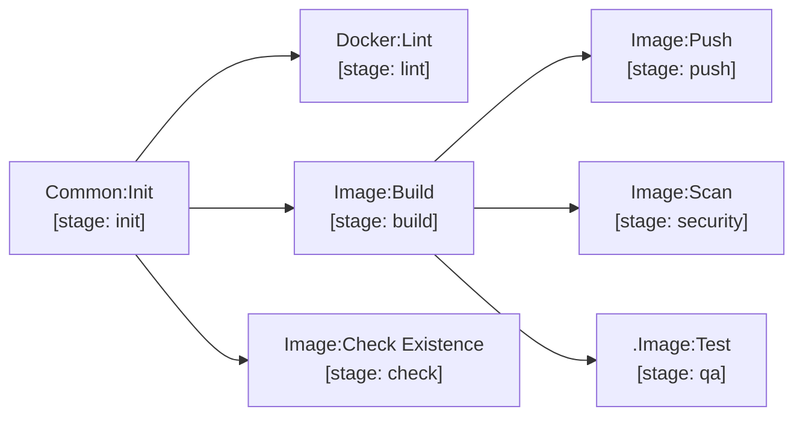

# image

Container image building and registry management supporting both Docker and Buildah.

| Job / Template | Stage | Description |
| --- | --- | --- |
| `Docker:Lint` | `lint` | Hadolint Dockerfile linting with configurable ignores. |
| `Image:Build` | `build` | Docker/BuildKit build with build-args injection. Saves image tar artifact. |
| `Image:Check Existence` | `check` | Verifies the image tag does not already exist in any image repository before release. In the `image-scan` workflow, verifies the target exists in the primary repository. |
| `Image:Push` | `push` | Publishes the image to every image repository, logging in to each registry once; every repository is tried before the job fails. |
| `Image:Promote` | `release` | Release only. Copies the scanned candidate to the production repository with Crane and tags `latest`, `MAJOR` and `MINOR`, in the primary repository, then copies the release by digest, with those tags, to every other repository. |
| `Image:Scan` | `security` | Trivy CVE scan on local image tar (or pulls remote image in `image-scan` workflow). |
| `.Image:Test` | `qa` | Runs `ci_image_test.sh` **inside the built image** before it is scanned or pushed. Opt-in: extend it only where the image has a contract worth asserting — entrypoint on `PATH`, `EXPOSE` port listening, process running as `10001`. GitHub's equivalent is `docker.yml` `test: true`. |

[Dockerfile standards and examples](../docker.md) · [Documentation index](../../README.md)
