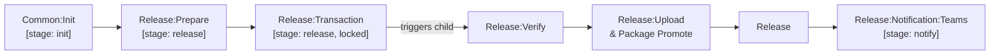

# release & notify

The `release/.gitlab-ci.yml` module provides the complete serialized release transaction and notification dispatch:

- `Release:Prepare`: Downloads the candidate manifest `candidate.json` from the Generic Package Registry, validates provenance, and generates the downstream `release-pipeline.yml` specification.
- `Release:Transaction`: Bridge job with `resource_group: production-release` triggering `release-pipeline.yml` with `strategy: depend`, atomically executing all release operations without concurrent race conditions.
- `Release:Verify`: Verifies candidate deliverables (dev image, dev chart, job reports, declared packages) and protects against version collisions.
- `Release:Upload`: Promotes declarative packages to stable Generic Packages with SHA256 validation, fetches verified reports from producing job IDs, and uploads release assets (Trivy report bundle, taking each `parallel:matrix` root's reports under its `PROJECT_PATH`, installed packages, SBOM, `${CHART_NAME}-${TAG}.tgz`, test report archive, and requested additional artifacts) to the Generic Package Registry, and exports the scoped markdown summaries, including `${RELEASE_MIGRATION_FILE_NAME}`, as job artifacts for the release description. Migration notes are not uploaded to the package registry by default. Failures fail the pipeline (no `allow_failure`).
- `Release`: Receives the scoped markdown summaries, generates the formal GitLab Release with consolidated changelog, migration notes, CVE summary tables (one section per Terraform root when the Terraform jobs run as a matrix), image SHA digests, chart info, license audit, and clickable asset download links without overwriting existing descriptions on retry.
- `Release:Notification:Teams`: Dispatches Microsoft Teams Adaptive Cards with commit, branch, author avatar, release links, and SonarQube status buttons via Power Automate webhook URL (`RELEASE_MESSAGE_TEAMS_WORKFLOWS_URL`).

[Documentation index](../../README.md)
